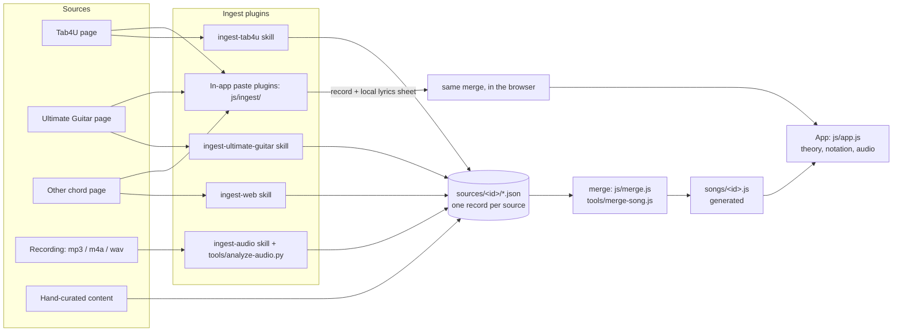

# GitBuzz architecture

GitBuzz has three layers. Data flows one way, from sources to records to songs to the app.



The `add-song-by-url` skill is the router. It looks at a link, file or song name, picks the plugin, then runs the merge, the validator and the commit.

## 1. Data layer

### Source records

Each plugin writes **one record per source** to `sources/<song-id>/<plugin>[-name].json`:

```json
{
  "plugin": "tab4u",                 // tab4u | ultimate-guitar | web | audio | paste | manual
  "ref": "https://www.tab4u.com/…",  // page URL, file name, or a short description
  "fetched": "2026-10-11",
  "confidence": "high",              // high | medium | low: how much to trust this source
  "fields": {
    "name": "…", "artist": "…", "credits": "…",
    "key": { "tonic": 9, "mode": "minor" },          // only if the source states it
    "bpm": 136, "tuningCents": -1,                   // audio, or a published tempo
    "lines": { "Verse": [["E","Dm"],["F","Am"]] },   // chords per lyric line, per section
    "sections": { "Verse": [["D",4],["G",4]] },      // timed loops (audio or manual only)
    "timeline": [ … ],                               // audio: one chord guess per bar
    "hasTab": ["Intro"],                             // sections the source has a tab for
    "links": [["label","https://…"]],
    "missions": […], "guide": {…}, "licks": […], "tempoNote": "…",   // manual only
    "notes": ["anything guessed or surprising"]
  }
}
```

**Rules for records:**
- **No lyrics.** The repo is public, so `lines` holds chord symbols only, one array per lyric line. Fields named `lyrics`, `text`, `sheet` or `words` are rejected by the validator.
- **No note-by-note tabs** copied from a source. `hasTab` records that a tab exists, and the source link points to it.
- A record says only what its source says. Guesses go in `notes`.

### Superposition (merge)

`js/merge.js` combines all of a song's records, field by field. The same code runs in Node (`tools/merge-song.js`) and in the browser (the paste import).

| Field | Taken from, best first | Notes |
|---|---|---|
| name, artist, credits | manual, tab4u, ultimate-guitar, web, paste, audio | Differences are listed as conflicts |
| key | manual, then any source that states it, otherwise **guessed from all chords** | The audio key estimate is a cross-check (a relative major or minor counts as agreement) |
| bpm | manual, audio, ultimate-guitar, web, tab4u, paste; otherwise 100 | Differences over 3% are conflicts |
| sections | **per section**: manual, audio (timed); otherwise derived from the best `lines` | Derived = flatten, repeating unit, at most 16 chords, 4 beats each |
| lines | tab4u, ultimate-guitar, paste, web, manual | |
| missions, guide, licks, tempoNote | manual | tempoNote is written automatically from the provenance if missing |
| links | every source page, then each record's links, plus Spotify and UG search links | |

The merged song carries `sources`, `provenance` (which plugin supplied each field and each section), `conflicts` and `notes`. The app shows them under **"Where this song's data comes from"**.

`songs/<id>.js` files are **generated**. To change a song, edit its records (usually `sources/<id>/manual.json`), then run `node tools/merge-song.js <id>`.

### Plugins

| Plugin | Claude side (skill) | In the app | Gives |
|---|---|---|---|
| tab4u | `ingest-tab4u` | Tab4U paste plugin | name, artist, credits, lines, hasTab |
| ultimate-guitar | `ingest-ultimate-guitar` | UG paste plugin | name, artist, key (if stated), lines |
| web | `ingest-web` | generic chord-sheet plugin | lines, sometimes name, artist or bpm |
| audio | `ingest-audio` + `tools/analyze-audio.py` | none (no audio analysis in the browser) | bpm, tuning, key estimate, timed sections |
| manual | by hand | the edit fields in the import preview | teaching content, corrections, curated loops |

**To add a source type:**
1. Add a skill in `.claude/skills/ingest-<name>/SKILL.md` that writes a record in the format above.
2. If people will paste that site's pages, register an in-app plugin in `js/ingest/plugins.js`: `detect()`, `parse()` and `matchUrl()`. The shared engine in `js/ingest/chordsheet.js` does the parsing.
3. Add the plugin name to `PRIORITY` in `js/merge.js`, and to `PLUGINS` in `tools/validate-songs.js`.

### Lyrics and chord-to-lyric matching

Lyrics live only in the user's browser. When a song page is pasted into the app, the chord-sheet engine pairs each chord line with the lyric line under it. Chords keep their column position for left-to-right text; for Hebrew, they are spread over the words in reading order. The resulting sheet is saved in `localStorage` under that song, shown in the **Song sheet** panel, and never uploaded. The chords-only part becomes a `paste` record for the merge.

## 2. Core logic (`js/`)

| File | Role | DOM |
|---|---|---|
| `theory.js` | note names, `parseChord`, scales, pentatonic boxes, `guessKey` | no |
| `notation.js` | text tabs for the guide and licks | no |
| `audio.js` | Web Audio synth | audio only |
| `merge.js` | superposition of source records | no |
| `ingest/*.js` | in-app plugins and the chord-sheet engine | no |
| `songs.js` | song registry (`GitBuzz.registerSong`) | no |
| `app.js` | state, rendering, players, import UI | yes |

These are plain scripts that share `window.GitBuzz`, so `index.html` works when opened straight from disk. Core files never refer to a specific song.

## 3. Checks

- `node tools/validate-songs.js` checks song files, records (including the no-lyrics rule), fret positions and lick lengths, and that generated files are up to date.
- `node tools/merge-song.js --check` checks only that the generated songs match their records.
- `tools/fixtures/` holds invented sample pages for testing the paste plugins.
